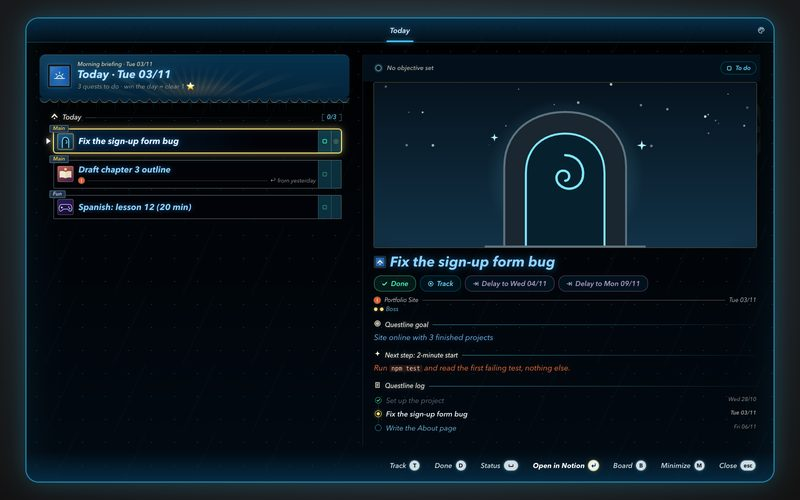
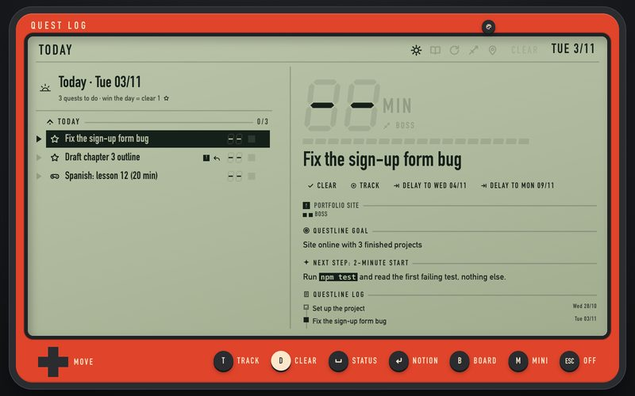
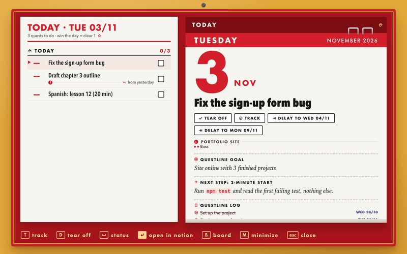
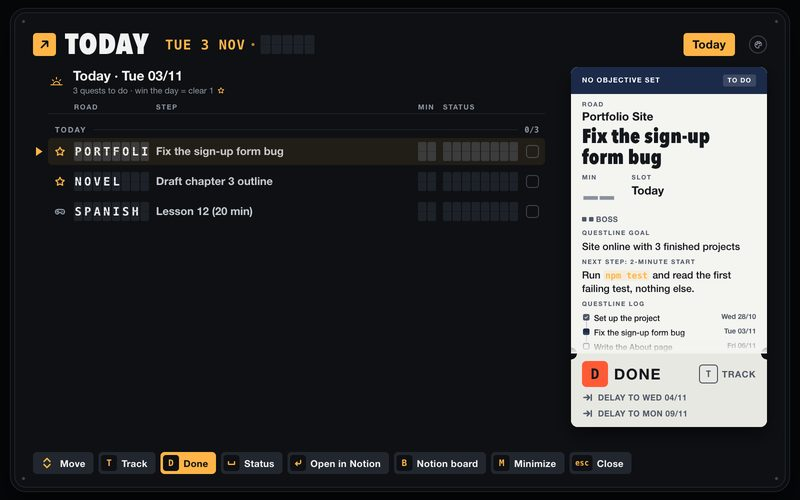
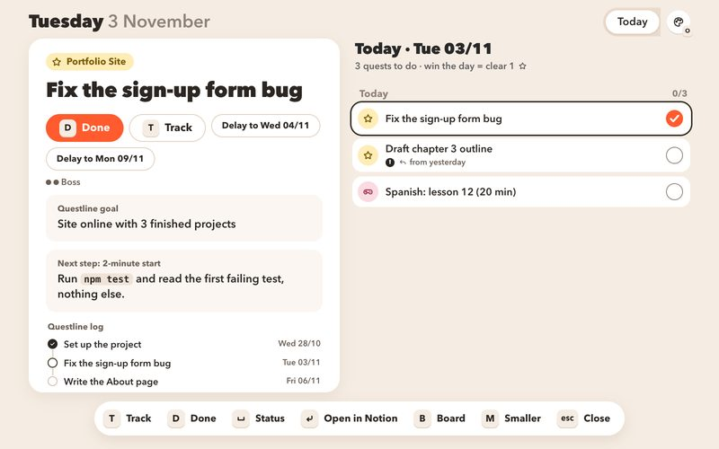
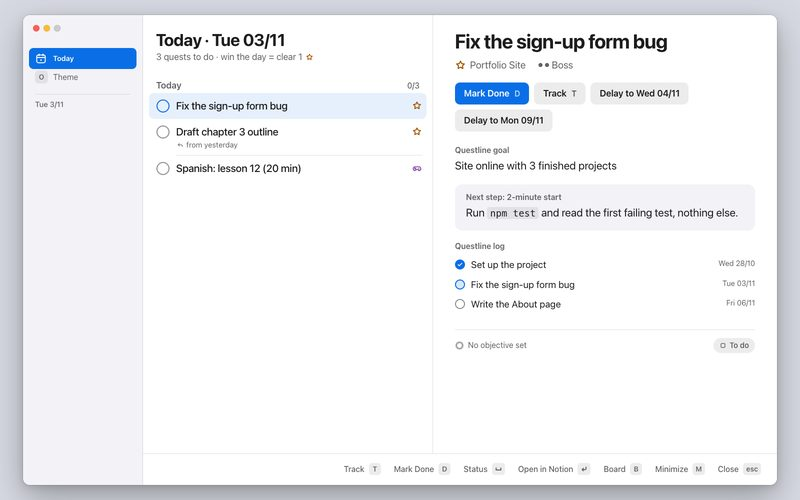
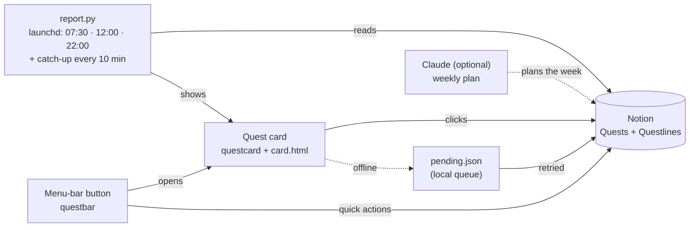

# Quest Log

**A personal task manager for macOS that hands you your day as a quest list.**

Your tasks stay in Notion. Quest Log brings them to your screen three times a day as a card you can work from the
keyboard: tick a quest off, start tracking it, push it to tomorrow. Every change is back in Notion a few seconds later.


<sub>The Tear-off calendar theme, with made-up sample quests. Five more themes are [further down](#six-themes).</sub>

Want to look before installing anything? Open `card.html` in Safari or Chrome and add
`?kind=morning&mode=full&theme=calendar` to the address. It runs on sample data and needs nothing else.

## Why I built it

My quests already lived in a Notion database. Writing them down was never the problem; going back to look was. A list
you have to remember to open is a list you stop opening.

So I turned it around and made the list come to me. At 07:30 the Mac shows what today is about, at noon what is left,
at 22:00 how the day went. In between, a small card checks in every two hours while something is still open. The
game-menu look is there because it makes ticking things off more fun than it has any right to be.

It started as a scheduled AI task that drew the cards for me. Today everything runs on the Mac, and the AI part is an
optional weekly planner that nothing else depends on.

## The rules it is built around

- **One ⭐ Main quest a day.** Clear it and the day counts as won, whatever else happens.
- **At least one 🎮 Fun quest.** Rest goes on the plan too.
- **Every quest has a 2-minute start**, a first step small enough that starting is never the hard part:
  *Run `npm test` and read the first failing test, nothing else.*
- **Nothing to remember.** Miss a card and it waits until you are back at the Mac. It never stacks three on top of
  each other.

## A day with Quest Log

| when | what shows up |
|---|---|
| 07:30 | **Morning briefing**: today's quests, with anything carried over from yesterday marked ↩︎ |
| every 2 hours, 09:00–21:00 | **Check-in**: a small corner card with what is still open, only while you are at the Mac |
| 12:00 | **Midday check**: what is left |
| 22:00 | **Evening report**: how many you cleared, whether the ⭐ got done, your streak, tomorrow's plan |
| any time | **⌃⌥Q** or the menu-bar button opens the card for the time of day |

<p align="center">
  
  &nbsp;&nbsp;
  
</p>
<p align="center"><sub>Left: the morning briefing in its corner size. Right: a deadline 14 minutes out.</sub></p>

## What it does

- **Work from the card.** Tick a quest off, track one (the menu bar shows a running timer), delay it to tomorrow or
  next Monday, undo, or jump to its page in Notion.
- **A menu-bar button** with today's list and a one-line quick add: `Buy batteries | check which size first` creates a
  quest with its 2-minute start, and a `*` in front makes it the ⭐ Main quest.
- **Deadlines that get louder.** Three hours out you get a badge, one hour out a card with a sound, fifteen minutes
  out an alert every ten minutes. Away from the Mac? It can push to your phone through ntfy.sh (off by default).
- **Offline is fine.** A click that can't reach Notion waits in a local queue and goes out when the network is back.
- **Week tab.** This week's goals from Notion, one column per area of your life. When a goal's quests are all done,
  you claim it by writing one line about what you got out of it.
- **Study tab.** It shows only when `learn.json` exists next to `report.py`. The app reads it each time a card opens.
One thread at a time: `active` lists the roads that run (the rest are parked behind one line in Roads), `days` the weekdays
that have a lesson. Plan shows Today (Recall and today's lesson), Tomorrow, and Later: the next lessons if you keep going.
Nothing pinned? The first card of the day adds today's lesson by itself (the next one on the road that belongs to today). A lesson
you pin (P) is kept until it is today's, even over a skipped day. Each road says where you are: "Lesson 3 of 25 · ~20 h left".

```json
{
  "active": ["road1"], "days": ["Mon", "Tue", "Wed", "Thu", "Fri"],
  "tracks": [{
    "id": "road1", "name": "My road", "short": "Road", "color": "#9BE38B", "goal": "…", "project": "…", "end_goal": "…",
    "milestones": [{ "name": "First steps", "reached_when": "something you can run",
      "sessions": [{ "title": "…", "resource": "…", "url": "…", "minutes": 50, "min": "the first step", "done": "what is true when it is done", "recall": "a question" }] }]
  }],
  "max_pins": 3, "recall_cap": 20, "recall_retention": 0.9, "recall_leech": 4, "recall_valve": [15, 0.85]
}
```

One project per road keeps it easy to follow; roads that share a topic are separate roads. A milestone's lessons may be written inline
(as above) or as numbers into the track's `sessions` list. Every milestone ends in a 30-minute Boss the card adds itself.
`rhythm` (`{"Mon": ["ai"], …}`) still picks the road for a weekday when more than one runs; without it, the running roads take
turns. Recall shows at most `recall_cap` cards a day and aims for `recall_retention`; if the last 30 days averaged more than 15 a
day it aims for 0.85 instead (`recall_valve`). A card forgotten `recall_leech` times asks you to rewrite it or park it.

`study.json` is written by the card after every change: where you are on each road, tomorrow's pins, today's lessons,
Recall cards with their next date, and the line you wrote after each lesson. Delete it to start over. Today's lessons
and Recall also sit on top of the Today list; marking them done never writes to Notion. The 22:00 card opens on Study
until a lesson is pinned for tomorrow.

**Week tab.** This week's goals from Notion, one column per area of your life. When a goal's quests are all done,
  you claim it by writing one line about what you got out of it.
- **Study tab.** Learning roads made of short lessons, plus spaced-repetition recall cards. It lives in local files
  and never touches Notion.
- **Six themes**, each with its own sounds, all synthesized in Python.
- **No AI needed day to day.** Claude can plan the coming week on Sunday evening if you want it to.

## Six themes

Press <kbd>O</kbd> on the card (or click the palette). <kbd>↑</kbd> <kbd>↓</kbd> previews, <kbd>Enter</kbd> keeps it,
and the sounds change with it.

<table>
  <tr>
    <td width="50%"><br>
      <b>Default</b>: the original dark quest menu.</td>
    <td width="50%"><br>
      <b>Pocket LCD</b>: an old handheld game. Every icon is printed on the screen and lights up when it is true, and
      it beeps like a piezo buzzer.</td>
  </tr>
  <tr>
    <td><br>
      <b>Tear-off calendar</b>: today as a sheet of a Vietnamese <i>lịch bloc</i>. Clearing a quest tears it off, and
      it sounds like paper on a desk.</td>
    <td><br>
      <b>Departure board</b>: your day as an airport board, each quest a row with its road, next step and minutes.</td>
  </tr>
  <tr>
    <td><br>
      <b>Soft cards</b>: roomy cards on warm cream, one bright colour, rounded pops and a small marimba.</td>
    <td><br>
      <b>Standard</b>: for when you want it to look like any other Mac app.</td>
  </tr>
</table>

## Keyboard

Click the card once first. Keys only work after that, so typing in another app never ticks off a quest.

| key | does |
|---|---|
| <kbd>↑</kbd> <kbd>↓</kbd> or <kbd>J</kbd> <kbd>K</kbd> | move between quests |
| <kbd>D</kbd> | done; press again to take it back |
| <kbd>T</kbd> | track or untrack (one quest at a time) |
| <kbd>Space</kbd> | action menu: clear, track, delay to tomorrow, delay to next Monday, to do, undo, open in Notion |
| <kbd>Enter</kbd> | quest details; <kbd>Enter</kbd> again opens it in Notion |
| <kbd>B</kbd> | your board in Notion |
| <kbd>M</kbd> | full screen ⇄ corner card |
| <kbd>O</kbd> | themes |
| <kbd>Esc</kbd> | close the menu, then the details, then the card |
| <kbd>⌃</kbd> <kbd>⌥</kbd> <kbd>Q</kbd> | open the card from anywhere |
| <kbd>⌃</kbd> <kbd>⌥</kbd> <kbd>D</kbd> | add a deadline in one line: `Pay rent, fri 17:00` or `Call the bank in 3h` |

## Install

There is no download yet. You build it from source: two `swiftc` calls and a few Python scripts, nothing to
`pip install`. Because you build it yourself, macOS has nothing to quarantine and there is no Gatekeeper prompt.

**You need** macOS with the Xcode Command Line Tools (`xcode-select --install`), a Notion workspace and a free Notion
integration token. I build and use it every day on macOS 26 on Apple Silicon; other recent versions should work but
are untested.

1. **Get the code** into a folder that will stay put (the schedule points at it):
   ```bash
   git clone https://github.com/ThachCoder2k2/questlog.git ~/Library/Application\ Support/QuestLog
   cd ~/Library/Application\ Support/QuestLog
   ```
2. **Build the two apps and the sounds:**
   ```bash
   swiftc -O QuestCard.swift -o questcard -framework Cocoa -framework WebKit
   swiftc -O QuestBar.swift -o questbar -framework Cocoa -framework Carbon
   python3 make_sounds.py
   python3 cardsrc/make_theme_sounds.py
   ```
3. **Create the Notion databases** ([Notion databases](#notion-databases)) and put their IDs in the code: `QUESTS_DB`,
   `QUESTLINES_DB` and `WEEK_DB` in `report.py`, your board page in `boardURL` (`QuestCard.swift`, `QuestBar.swift`)
   and `BOARD` (`show_card.py`). Rebuild after changing the Swift files.
4. **Connect Notion** ([below](#connect-notion)), then check that it can read your databases:
   ```bash
   python3 report.py check
   ```
5. **Turn it on:**
   ```bash
   python3 report.py install --live
   ```
   This loads the LaunchAgents for 07:30, 12:00, 22:00, the 10-minute catch-up and the menu-bar button.
   `python3 report.py status` shows what is installed and `python3 report.py uninstall` removes all of it.
6. **Try it:** click the button in the menu bar, or run `python3 report.py now`.

## Connect Notion

The Mac needs its own key to Notion, an integration token. With it, every click on the card or in the menu bar is
written to Notion within seconds. Without it, clicks only wait in the local queue.

1. Open [notion.so/profile/integrations](https://www.notion.so/profile/integrations) → **New integration** (or New
   connection) → type **Internal** / **API token**, pick your workspace, Save.
2. **Capabilities**: Read content, Update content, Insert content ("Add deadline…" needs Insert).
   User capabilities: No user information.
3. **Content access** (or, on the page: ••• → Connections → Connect to): add the page that **contains the two
   databases**.
4. Copy the token, then right-click the menu-bar button → "⚠ Notion isn't connected: set it up…". A Terminal window
   opens (`set-notion-token.command`): paste the token, press Return, paste it again, Return. Nothing shows while you
   paste; that is normal. The token goes into the macOS Keychain (service `QuestLog Notion`, account `token`), never
   into a file.

## Notion databases

**Quests**

| property | type | values |
|---|---|---|
| Quest | title | |
| Type | select | `⭐ Main Quest`, `🧩 Side Quest`, `🎮 Fun` |
| Status | status | `📜 To Do`, `🔥 Grinding`, `⏸ Delay`, `✅ Cleared` |
| Date | date | the day it is planned for |
| Energy | select | `🐸 Mobs` (light), `🐉 Boss` (heavy), `🔒 Locked` (ignored) |
| 2-Min Start | text | the tiny first step, shown as "Next step" |
| Questline | relation → Questlines | |
| Due | date with time | optional deadline |
| Edited | last edited time | |
| On Today | formula (optional) | `"yes"` for quests on today's list; without it a built-in rule is used |

**Questlines**: `Questline` (title), `Done means` (text, shown as the questline goal), `Quests` (relation).

Quests without a Date sit on a "Quest Board" backlog. Each questline can have its own illustration: add a banner, a
tile and a name pattern to `ART` in `card.html`; other quests get the Main / Side / Fun default art.

<details>
<summary><b>Week Goals</b> (optional, for the Week tab)</summary>

Without this database the Week tab stays hidden.

| property | type | values |
|---|---|---|
| Goal | title | `Short name: what the week must produce`; the part before `:` is the short name |
| Week | date | the Monday of the week |
| Area | select | one column per area on the card, in the order of the options |
| Kind | select | `Learn`, `Work`, `Build`, `Life`: sets the question asked when you claim it |
| Done when | text | what is true when the goal is met |
| Status | select | `Planned`, `Accomplished` (set from the card), `Next week` (moved) |
| Result | text | your one line, written on the card when you claim it |
| Quests | relation → Quests | the quests that get you there |
</details>

## When something is off

**Every Notion call fails with 404.** The integration has to be connected to the page that *contains* the two
databases. Connecting a board page that only shows them is not enough.

**The keys do nothing.** Click the card once. That is on purpose: keys only reach the card after you have clicked it.

**The menu bar says "⏳ N changes not in Notion yet".** You were offline or Notion was down. The clicks wait in
`pending.json` and go out at login, after a wake-up and every 10 minutes. "Save now" sends them right away.

**The 07:30 card never came.** If the Mac was asleep or you were away, the card waits until you are back (the morning
one until 11:30) and then shows once. `python3 report.py status` lists which cards were shown today.

**I want the token gone.** `security delete-generic-password -s "QuestLog Notion" -a token`.

## How it works

Notion is the only source of truth. A Python runner reads it on a schedule, builds the card as JSON and hands it to a
small Swift app that draws it in a floating WebKit window. Your clicks go back to Notion directly, or through the local
queue when they can't.



| part | file | job |
|---|---|---|
| Card | `card.html` (HTML/CSS/SVG) + `QuestCard.swift` → `questcard` | draws the card in a floating window, sends clicks to Notion |
| Runner | `report.py` (Python 3, standard library only) | reads Notion, builds the cards, writes queued clicks, installs the schedule |
| Menu bar | `QuestBar.swift` → `questbar` | the button, quick actions, tracking timer, deadline badge |
| Queue | `pending.py` → `pending.json`, `applied.json` | clicks waiting for Notion, and a 14-day log of what was saved |
| Deadlines | `urgent.py`, `quickadd.py` | reminder ladder, phone push, "Add deadline…" |
| State | `qlstate.py`, `runs/` | which card was shown when, saved cards for offline use, logs |
| Sounds | `make_sounds.py` → `sounds/*.wav` | the menu sounds, synthesized in Python |
| Card source | `cardsrc/` → `make_card.py` → `card.html` | the card's parts: the Today / Week / Study tabs and the themes |
| Study | `learn.json` (yours), `study.json` (the card writes it) | learning roads, lessons, recall cards; neither file is in git |
| Themes | `prefs.json`, `cardsrc/make_theme_sounds.py` → `sounds/<theme>/` | the chosen theme and each theme's own sounds |

## Reference

<details>
<summary><b>When cards appear, exactly</b></summary>

| card | time | shown if you are at the Mac between |
|---|---|---|
| Morning briefing | 07:30 | 07:00 and 11:30 |
| Midday check | 12:00 | 11:30 and 21:30 |
| Evening report | 22:00 | 21:30 and 04:00 (after midnight it is still the previous day's report) |
| Check-in (corner card) | every 2 hours | 09:00 and 21:00, when no card was on screen for 2 hours and quests are still open |

A check-in skips the hour before a scheduled card. Change the rhythm in `report.py` (`CHECKIN_EVERY`,
`CHECKIN_HOURS`). The card opens full screen; `"display": "compact"` in its data opens it as the corner card, and you
can drag the corner card by its header.
</details>

<details>
<summary><b>Menu-bar button</b></summary>

Click it or press ⌃⌥Q to open the card for the time of day (or the last saved one when offline). Right-click for:

- today's quests, each with Clear · Track · To do · Delay to tomorrow · Delay to next Monday · Open in Notion (the list
  is re-read from Notion every 10 minutes and right after each change);
- **↶ Undo** (⌘Z while the menu is open) for the last change made in the menu, for 30 minutes;
- **Add quest for today…**: one line, e.g. `Buy batteries | check which size first` (text after ` | ` is the 2-minute
  start; `*` in front makes it a ⭐ Main quest);
- the other cards, "Add deadline…" (⌃⌥D) and the board.

Next to the icon: today's cleared/total, or "▶ 12m" while a quest is tracked, or "!" when a deadline is close.
</details>

<details>
<summary><b>Deadlines and phone push</b></summary>

Give a quest a **Due** date and time in Notion, or type one line in "Add deadline…", for example `Pay rent, fri 17:00`
or `Call the bank in 3h`.

| time left | what happens |
|---|---|
| 3 h | amber badge, one quiet card |
| 1 h | red blinking badge, card with a sound |
| 15 min | card with the alert sound, again every 10 min |
| overdue | alert card again every 30 min (stops 3 days later) |

The deadline card has **Start** (T), **Done** (D) and **Snooze 15 min** (S).

While you are away from the Mac (no input for 10 minutes, or the screen locked) and the Mac is awake, the 1 h, 15 min
and overdue steps can go to your phone through [ntfy.sh](https://ntfy.sh) instead of waiting for a card. It is off by
default:

```bash
python3 urgent.py push setup     # makes push.json (private, not in git) with a random topic
python3 urgent.py push sample    # shows exactly what would be sent
python3 urgent.py push enable    # also: disable | status | test | newtopic
```

Install the ntfy app and subscribe to the topic. Anyone who knows the topic can read the notifications, so treat it
like a password; set `"titles": false` in `push.json` to send no quest titles or links.
</details>

<details>
<summary><b>report.py commands</b></summary>

| command | does |
|---|---|
| `python3 report.py morning` (or `midday`, `evening`) | write queued clicks, read Notion, show the card |
| `… --dry-run` | print the card JSON only: no Notion writes, queue untouched, no card |
| `… --today 2026-10-21` | build the card for another day |
| `python3 report.py now [KIND]` | open a card now (what the menu-bar button runs) |
| `python3 report.py apply` | write the queued clicks to Notion now, then refresh the menu bar's list |
| `python3 report.py catchup` | what the 10-minute agent runs: send queued clicks, refresh the menu bar, deadlines, a missed card or a check-in |
| `python3 report.py checkin [--dry-run]` | show the check-in card now |
| `python3 report.py refresh` | re-read the board for the menu bar (today's list, cleared/total, deadlines) |
| `python3 report.py add -- "TITLE, WHEN"` | create a deadline quest |
| `python3 report.py add-today -- "TITLE \| 2-MIN START"` | create a quest for today (`*` in front = ⭐ Main) |
| `python3 report.py status` | mode, token, which cards were shown today, saved cards |
| `python3 report.py check` | token, Notion access, row counts |
| `python3 report.py install [--live]` / `uninstall` | LaunchAgents in `~/Library/LaunchAgents/com.questlog.*` |
| `python3 report.py shadow KIND`, `compare KIND` | compare the cards with ones made by a Claude task |

`install` without `--live` installs **shadow mode**: the agents only build cards in the background and compare them
with the cards a Claude task showed (`runs/compare.log`). That is how I checked the local runner against the old AI
task before switching over. Queued clicks are written in both modes.
</details>

<details>
<summary><b>Catch-up after sleep, shutdown or time away</b></summary>

- launchd runs a job that was due during sleep as soon as the Mac wakes; `questbar` also runs the catch-up 5 s after a
  wake-up or an unlock.
- `com.questlog.catchup` runs at login and every 10 minutes. It first writes queued clicks to Notion, then shows the one
  card that is due and unseen, only once you are back (keyboard or mouse used in the last 10 minutes) and never on top
  of an open card. A newer card covers older ones, so a late start shows one card, not three.
- On Sundays the evening window ends at 22:30, when the weekly plan may start moving quests.
- Every card shown is saved in `runs/last-KIND.json`, so the menu-bar button works offline; a saved card says when it
  was made ("Saved 22:11").
</details>

<details>
<summary><b>Optional: Claude as the weekly planner</b></summary>

Claude (Anthropic's AI assistant) can run as a scheduled task on Sunday evening: it reads the board, carries unfinished
quests into next week, gives every day one ⭐ Main and at least one 🎮 Fun quest, and pops up the week as a card. It
writes to Notion through its own Notion connector and applies any queued clicks first. The prompt is not part of this
repository. If it doesn't run, unfinished quests simply show up as carried (↩︎) on the next morning card.
</details>

<details>
<summary><b>Card data (JSON)</b></summary>

`python3 show_card.py card.json` shows any card (it falls back to a plain dialog if `questcard` is missing).

| field | type | notes |
|---|---|---|
| kind | `"morning"` \| `"midday"` \| `"evening"` \| `"weekly"` \| `"urgent"` | colour theme and icon; urgent = the deadline card |
| eyebrow, title, subtitle | string | header lines (subtitle optional) |
| progress | `{done, total}` | optional stamina wheel |
| stats | `[{icon, value, label}]` | optional chips |
| sections | `[{heading, items, empty}]` | quest lists; `empty` = text when there are no items |
| xp | `[{name, done, total}]` | optional progress bars per questline (weekly) |
| callout | `{label, text}` | a 2-minute start for older data without `start` |
| note | string | small line at the bottom |
| url | string | board link for "Board" |
| display | `"full"` \| `"compact"` | full screen (default) or corner card |
| timeoutSec | number | auto-close, default 1800 |
| sound | string | `""` mutes the card |
| week | `{label, start, end, today, next, areas, goals}` | optional: the Week tab; `goals` = `[{id, area, kind, short, title, when, status, result, quests}]`, `status` is `planned`, `accomplished` or `moved`, `quests` are items |
| tab | `"week"` \| `"learn"` | optional: the tab the card opens on |

Item: `{type: "main"|"side"|"fun", title, url?, status?, date?, label?, tags?, live?, done?, start?, questline?, goal?, energy?, steps?}`

- `url`: the quest's Notion page; without it the row can't be opened or changed.
- `status`: the Notion Status exactly; Undo restores it. `date` (`YYYY-MM-DD`) is needed for "Delay".
- `start`: the 2-Min Start (wrap shell commands in backticks). `steps`: the questline's quests `[{title, url?, date?, done?}]`.

Sounds: put your own files in `sounds/custom/` (same names as in `sounds/`, `.wav` `.aiff` `.caf` `.m4a` `.mp3`) to
replace the built-in ones; they stay on your Mac (`.gitignore`).
</details>

<details>
<summary><b>Card source, Study tab and themes</b></summary>

`card.html` is built from `cardsrc/`. Edit the files there, then rebuild:

```bash
python3 cardsrc/make_card.py
```

| file | what it is |
|---|---|
| `cardsrc/base.html` | the card before the tabs and themes |
| `cardsrc/v4.css`, `cardsrc/v4.js` | Today / Week / Study, Recall, the roads, Boss, light day |
| `cardsrc/themes.js` | what the themes share: pictograms, minute cells, the words map, and `THEME_EXT`, where a theme registers its words, decorations, Done moment and sounds |
| `cardsrc/theme_lcd.css`, `theme_cal.css` | Pocket LCD and Tear-off calendar |
| `cardsrc/theme_<key>.css`, `theme_<key>.js` | one file pair per later theme (`board`, `soft`, `mac`); a theme is in the picker once its CSS exists |
| `cardsrc/make_themes.py`, `make_card.py` | put it together; nothing personal goes into `card.html` |

`python3 cardsrc/make_card.py --themes board --out /tmp/card.html` builds a card with only that later theme (the
others left out), which is handy while one theme is being worked on.

**Study tab.** It shows only when `learn.json` exists next to `report.py`. The app reads it each time a card opens.
Shape (all keys used by the card):

```json
{
  "tracks": [{
    "id": "cv", "name": "Computer vision", "short": "Vision",
    "sessions": [{ "title": "…", "minutes": 45, "min": "2-minute start", "done": "done when…", "recall": "a question" }],
    "milestones": [{ "name": "…", "reached_when": "…", "sessions": [1, 2, 3] }]
  }],
  "rhythm": { "Mon": ["cv"], "Tue": ["cv"] }, "max_pins": 3,
  "recall_cap": 20, "recall_retention": 0.9, "recall_leech": 4, "recall_valve": [15, 0.85]
}
```

`rhythm` is the road suggested for each day. Milestone `sessions` are 1-based indexes into the track's `sessions`.
Recall shows at most `recall_cap` cards a day and aims for `recall_retention`; if the last 30 days averaged more than
15 cards a day, it aims for 0.85 instead (`recall_valve`). A card forgotten `recall_leech` times asks you to rewrite it
or park it.

`study.json` is written by the card after every change: where you are on each road, tomorrow's pins, today's lessons,
recall cards with their next date, and the line you wrote after each lesson. Delete it to start over. Today's lessons
and recall cards also sit on top of the Today list; marking them done never writes to Notion. The 22:00 card opens on
Study until a lesson is pinned for tomorrow.

**Week tab.** Shows this week's goals from the Week Goals database, one column per area, each with the quests that get
you there. A goal whose quests are all cleared says "Claim it": press D, write one line, Enter. The claim goes to
`runs/goal-claims/` and `report.py apply` writes it to the goal's page (Status and Result); the 10-minute catch-up
retries anything that could not be sent. D on a claimed goal takes it back. Enter opens the goal in Notion. No goals
this week, no Week tab.

**Themes.** The choice is saved in `prefs.json` and switches the sounds too: `sounds/<theme>/`, made by
`cardsrc/make_theme_sounds.py`. The app loads every folder in `sounds/` (except `custom`) as a theme's pack.
</details>

<details>
<summary><b>Tests</b></summary>

```bash
tests/run.sh
```

About 230 checks (time windows, catch-up, queue and sync, deadlines, quick add, phone push, evening numbers…) in a
throw-away sandbox: a temp copy of the scripts, a fake `questcard` and `osascript`, the network stubbed. It touches no
real state and sends nothing to Notion or ntfy.sh.

The card itself has a UI robot: `python3 tests/ui/run_ui.py` clicks and types through every theme in the corner card and
the full card in a real WebKit view (see `tests/ui/README.md`).
</details>

## Status

I use Quest Log every day, and it is built around how I work: Notion as the only backend, one Main quest a day, cards
that come to you instead of a window you have to open. Issues and ideas are welcome; it moves at the pace of my own
quest list.

## Credits

The look started as a fan homage to the menus of *The Legend of Zelda: Tears of the Kingdom*, which you can still see
in the Default theme. Quest Log is not affiliated with or endorsed by Nintendo and uses no game assets: every
illustration is original SVG drawn in `card.html`, and every sound is synthesized by `make_sounds.py` and
`cardsrc/make_theme_sounds.py`.
